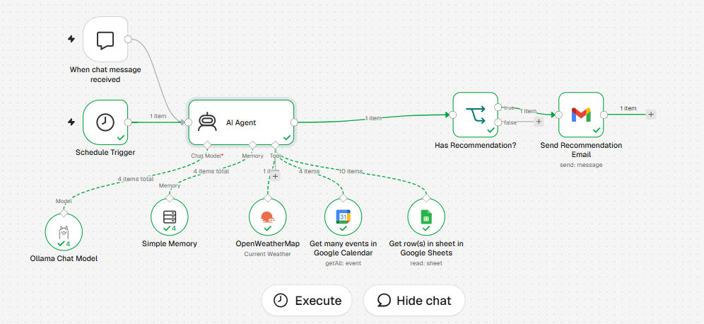

# TrailWise AI 🏃‍♂️⚡

An autonomous, hyper-local trail-running and trekking recommendation system for **Thiruvananthapuram, Kerala**.

TrailWise AI combines a local LLM (**Ollama `llama3.2`**) with **n8n** automation. Every day it checks your calendar, the live weather and a local trail database, then emails you a trail recommendation. It runs on your own machine, so there are no LLM API fees and your data stays with you.



---

## 🏗 System Architecture

```text
 +------------------+      +----------------+
 | Schedule Trigger |      |  Chat Trigger  |
 +--------+---------+      +--------+-------+
          |                         |
          +------------+------------+
                       |
                       v
            +---------------------+
            |      AI Agent       |<----- Ollama Chat Model (llama3.2)
            |                     |<----- Simple Memory
            |                     |<----- Tool: Google Calendar (Events)
            |                     |<----- Tool: OpenWeatherMap (Live Temp/RH)
            |                     |<----- Tool: Google Sheets (Trails DB)
            +----------+----------+
                       |
                       | (agent output)
                       v
            +---------------------+
            | Has Recommendation? |
            |      (IF Node)      |
            +----------+----------+
                       | true
                       v
            +---------------------+
            | Send Recommendation |
            |    Email (Gmail)    |
            +---------------------+
```

The Ollama model, memory and the three tools are sub-nodes attached to the agent. It calls them as needed, and its output goes to the IF node.

---

## ✨ Features

- **Schedule & Chat triggers:** the Schedule Trigger runs the daily routine; the Chat Trigger is for manual testing.
- **AI Agent core:** decides which tools to call, weighs the results and writes the recommendation.
- **Ollama Chat Model (`llama3.2`):** a local open-source model, free to run and private.
- **Simple Memory:** keeps conversation context for the agent session.
- **Calendar evaluation:** reads Google Calendar for keywords (Trail, Run, Trek, Hike) to see whether a run is planned.
- **Live weather:** pulls temperature, humidity and cloud cover from OpenWeatherMap.
- **Trail database:** reads trail candidates (distance, elevation gain, shade level, difficulty) from a Google Sheet.
- **Conditional router (`Has Recommendation?`):** `<describe the exact condition here, e.g. "agent output is not empty">`, so blank emails are never sent.
- **Gmail dispatch:** sends the recommendation as a plain-text email. Once the workflow is active, it sends real emails.

---

## 🛠 Tech Stack

| Layer | Tool |
|---|---|
| Orchestration | n8n |
| Local LLM | Ollama (`llama3.2`) |
| Tunneling | ngrok (only if n8n cannot reach Ollama directly) |
| Integrations | Google Calendar, OpenWeatherMap, Google Sheets, Gmail |

---

## 📁 Repository Structure

```text
TrailWise-AI/
├── README.md                 # Project documentation
├── workflow.json             # Sanitized n8n workflow export (credentials removed)
├── docs/
│   ├── workflow-canvas.png   # Screenshot of the n8n canvas
│   └── email.jpeg             # Screenshot of a sample recommendation email
└── prompts/
    └── system_prompt.txt     # AI Agent system prompt template

---

## 🚀 Setup & Installation

### 1. Prerequisites

- An **n8n** instance (Cloud or self-hosted)
- **Ollama** with the model pulled:
  ```bash
  ollama pull llama3.2
  ```
- **ngrok**, only if your n8n instance is not on the same machine as Ollama:
  ```bash
  ngrok http 11434
  ```
  Use the generated `https://...ngrok...` URL as the Ollama base URL in n8n.
- Accounts and keys:
  - OpenWeatherMap API key
  - Google OAuth credentials with Calendar, Sheets and Gmail access

### 2. Prepare the trail sheet

Create a Google Sheet with these columns (see `data/trails_sample.csv`):

| trail_name | distance_km | elevation_gain_m | shade_level | difficulty | notes |
|---|---|---|---|---|---|
| Ponmudi Hill Trail | 8 | 450 | Some Shade | Moderate | Popular hill station trail |

### 3. Import the workflow

1. Download `workflow.json`.
2. In n8n, go to **Workflows → Import from File**.
3. Connect your credentials for Google Calendar, OpenWeatherMap, Google Sheets, Gmail and Ollama. The **Chat Model** connection is required for the workflow to run.
4. Point the Sheets node at your trail sheet.
5. Set the schedule time in the Schedule Trigger and check the location in the weather node.
6. Test with the Chat Trigger before activating the schedule.

### ⚠️ ngrok security note

A public ngrok URL with no authentication lets anyone who has the link use your Ollama model. Add ngrok basic auth or an IP restriction. Free ngrok URLs also change on every restart, so you will need to update the Ollama credential in n8n each time.

---

## 📨 Sample Output Email

```text
Subject: TrailWise AI: Recommended Run for Today - Ponmudi Hill Trail

Hi there!

Here is your personalized trail recommendation for today in Thiruvananthapuram:

[TRAIL] Recommended Trail: Ponmudi Hill Trail
- Distance: 8 km
- Elevation Gain: 450 m
- Estimated Running Duration: 01h 30m
- Shade Level: Some Shade | Difficulty: Moderate

[WEATHER] Weather Overview:
- Condition: Broken clouds
- Temperature: 31°C
- Humidity: 74%

[WHY] Why this trail today?
<replace with a real reasoning example from your run, e.g. it mentions the
calendar event, the heat and the shade level>

[SAFETY] Safety & Access Notes:
Popular hill station trail with scenic views.

Have a great run!
– TrailWise AI
```

---

## ⚠️ Limitations

- `llama3.2` is a small model and can be inconsistent at tool calling. Results may vary between runs.
- Recommendations depend on the quality and size of your trail sheet.
- Running duration is an estimate. `<explain how it is calculated>`.

---

## 🔧 Customization

- **City:** change the location in the OpenWeatherMap node.
- **Keywords:** edit the Calendar search terms.
- **Trails:** add or edit rows in the Google Sheet.
- **Behavior:** adjust `prompts/system_prompt.txt`.

